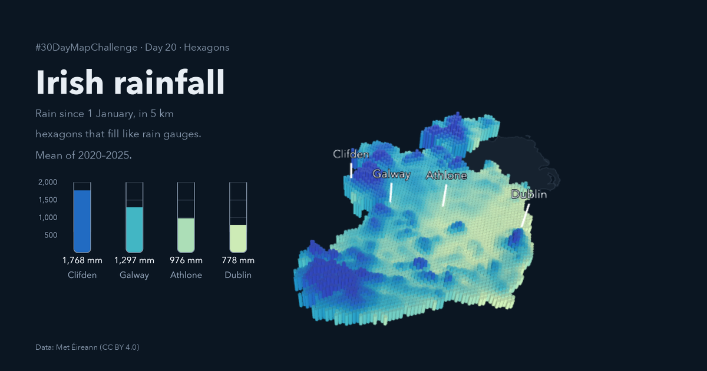

# Irish rainfall (Day 20 · Hexagons)

A 3D deck.gl map where each 5 km hexagon fills like a rain gauge from 1 January to 31 December (`docs/day20/`). Two views: the 2020–2025 average, or 2025 day by day. Pins and gauges follow a west–east line: Clifden → Galway → Athlone → Dublin.



## Findings

- 2020–2025 averaged 1,342 mm nationally, 4% above the 1991–2020 normal of 1,288 mm. 2025 had 1,338 mm.
- The extremes range from 718 mm on the north Dublin coast to 3,175 mm in the Caha Mountains on the Cork–Kerry border.
- The transect at 5 km gives 1,768 / 1,297 / 976 / 778 mm, so Clifden gets about 2.3× Dublin's rain.

## Data

| Source | Use |
|---|---|
| [Met Éireann 1 km monthly rainfall grids](https://clidata.met.ie/cli/grids/latest/), 2020–2025 | Average view |
| [Met Éireann 1 km daily rainfall grid](https://clidata.met.ie/cli/grids_daily/latest/rain/), 2025 | 2025 view |
| [Met Éireann 1991–2020 normals grid](https://www.met.ie/cms/assets/uploads/2024/07/IE_RR_9120_V2.zip) | Comparison column and check |
| Natural Earth 10m admin-1 (cartopy cache) | Coastline, Northern Ireland outline |

The grids are on Irish Grid (EPSG:29902) and cover the Republic only, so Northern Ireland is grey. HadUK-Grid would cover it but needs a CEDA account.

Met Éireann data is CC BY 4.0, and the attribution required is:

> Copyright Met Éireann. Source met.ie. This data is published under a Creative Commons Attribution 4.0 International (CC BY 4.0) licence. Met Éireann does not accept any liability whatsoever for any error or omission in the data, their availability, or for any loss or damage arising from their use. Modified: aggregated to hexagons.

Natural Earth is public domain.

## Method

- The average is each 1 km cell's mean for each calendar month over 2020–2025, spread evenly within each month.
- Hexagons are flat-topped, in ITM (EPSG:2157). Each value is the mean of the 1 km cells whose centres fall inside, and national means are weighted by land area.
- Hexagons are drawn whole, not clipped to the coast, since clipped slivers look like walls in 3D. Those with under 11.5% of a full hexagon's cells (headland tips, islets) are left out. Land area for the national means comes from clipping to the Natural Earth coastline.
- Columns are 18 m per mm, and colour runs dry to wet (YlGnBu without the darkest navy).
- 5 km is the web default. `?size=10` or `?size=15` gives the other sizes.
- Checking: the 1991–2020 normals put through the same hexagons give 1,288 mm, which matches Met Éireann's figure. The 2025 daily and monthly grids agree to within 3 mm.

## Make it

```bash
sh day20_rainfall_hexagons/fetch.sh data/met_eireann
```

```bash
for w in 5 10 15; do
  uv run --with numpy --with shapely --with pyproj --with pyshp python -I day20_rainfall_hexagons/hexes.py data/met_eireann day20_rainfall_hexagons/output $w
  uv run --with numpy --with shapely --with pyproj --with pyshp python -I day20_rainfall_hexagons/daily.py data/met_eireann day20_rainfall_hexagons/output $w 2025
  uv run --with numpy --with shapely --with pyproj python -I day20_rainfall_hexagons/export_web.py day20_rainfall_hexagons/output docs/day20 $w
done
```

```bash
python3 -m http.server 8765 --directory docs
```

Then open http://127.0.0.1:8765/day20/. With the server running:

```bash
uv run --with playwright --with matplotlib --with pillow python -I day20_rainfall_hexagons/make_preview.py http://127.0.0.1:8765/day20/ docs/day20/preview.png
```

- `fetch.sh` downloads about 55 MB to `data/met_eireann/`, which is gitignored.
- `hexes.py` writes `hex_rainfall_<W>km.csv` and `.geojson`: monthly, annual and normal mm per hexagon.
- `daily.py` writes `hex_daily_2025_<W>km.csv`, which is not committed because it reaches 17 MB at 5 km.
- `export_web.py` writes the JSON in `docs/day20/`. After re-exporting, bump `DATA_VERSION` in `app.js`.
- `make_preview.py` screenshots the page at 31 December in the installed Chrome and adds the title and town gauges, for the 1200 × 630 `preview.png` (landing page and link previews).

## Starting notes (`TASK-rainfall-hexagons.md`)

| Note | Result |
|---|---|
| 1991–2020 gridded averages, maybe 1 km | Confirmed: 1 km, monthly and annual. No rain days. |
| Daily station data, CC BY 4.0 | Confirmed: it moved to `clidata.met.ie`. Not used. |
| Northern Ireland via HadUK-Grid | Partly: the data exists (OGL) but needs a CEDA account. Left out. |

The original rain-days idea (≥1 mm) was dropped for monthly totals. The daily grids would support it: they matched stations within about 8% in a 2025 spot check.

## Not checked

- How Met Éireann interpolates the grids, or how many gauges each year used.
- Whether the grid coordinates are cell centres (assumed) or corners. Either way the difference is under 1 km.
